<picture>
  <source media="(prefers-color-scheme: dark)" srcset="docs/logo-dark.png">
  
</picture>

**Try it** [](https://centurius222.github.io/)**, no machine needed:** https://centurius222.github.io/ (the firmware's real interface with a simulated machine in your browser; nothing is saved).

<h2></h2>

## Why DeLongezzi <sub><sup><sub>YOUR MACHINE YOUR WAY</sub></sup></sub>
- **Stock functions stay STOCK:** brew and steam knobs work as always; one switch flips to DeLongezzi.
- **One board, no screen to wire:** a single ESP32-S3 N16R8; use an old phone, a tablet or a smart TV.
- **PT1000A (Class A high accuracy) probe** instead of a thermocouple: no more grounding issues.
- **Manual brew page:** easy to read, simple start/stop, pressure slider you can move mid-shot.
- 🔥 **HOT** **Themes:** holiday ones or your own, colors and all; hold the top-left corner to switch.
- **Your own look:** brew button picture or MP4 video, splash screen and logo (or the defaults).
- **Shots to profiles:** turn manual shots from your history into profiles.
- **Original GaggiMate pages** (profiles, brewing and the rest) still work as before.
- **Water-level sensor:** just two copper strips on the side of the tank.
- **Diagnostics tab** for easy troubleshooting.
- **Easy install:** web flasher, or one .bin file. **Easy to extend:** AI handover included, just ask Claude.

Based on [GaggiMate](https://github.com/jniebuhr/gaggimate) by Caffinnova S.r.l.
DeLongezzi is not made or endorsed by GaggiMate.

<p align="center">
  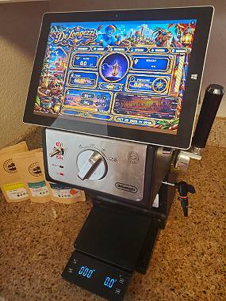&nbsp; 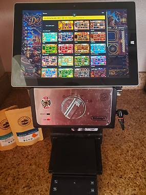&nbsp; 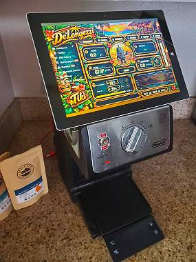
</p>

**Test drive, no machine needed:** [try it LIVE](https://centurius222.github.io/) in your browser, or [flash a bare N16R8 board](https://centurius222.github.io/DeLongezzi/flasher/) and explore it from your phone, tablet or PC.
[](https://centurius222.github.io/DeLongezzi/flasher/)

<br>

<h2></h2>

## Requirements
- **Machine:** best with DeLonghi ECP, EC and Stilosa ([which model?](docs/machines.md)); adaptable to any simple machine.
- **Single Board:** ESP32-S3 N16R8 (16 MB flash, 8 MB PSRAM); for another board, ask Claude to adapt the build.
- **2.4 GHz Wi-Fi:** the N16R8 board works on 2.4 GHz only; it will NOT work on 5 GHz.
- **A screen:** tablet, phone, PC or smart TV.
- **Browser:** Chrome (using other browsers might not work).
- **To install:** a computer with Chrome, and a USB data cable (charge-only cables don't work).

<h2></h2>

## Bill of Materials
<a href="docs/BOM.md">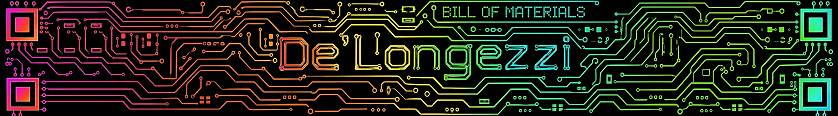</a>

Everything this build uses, 28 parts with pictures and shop links: **[parts list](docs/BOM.md)**.


<h2></h2>

## Plumbing
<a href="https://raw.githubusercontent.com/centurius222/DeLongezzi/main/docs/plumbing.jpg">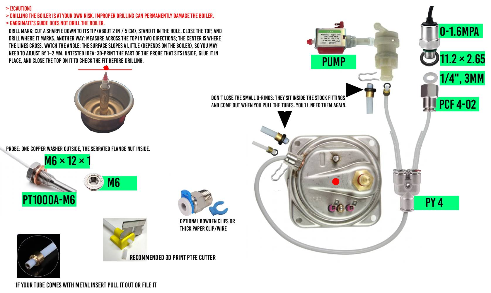</a>&nbsp; <a href="https://raw.githubusercontent.com/centurius222/DeLongezzi/main/docs/plumbing-1.jpg">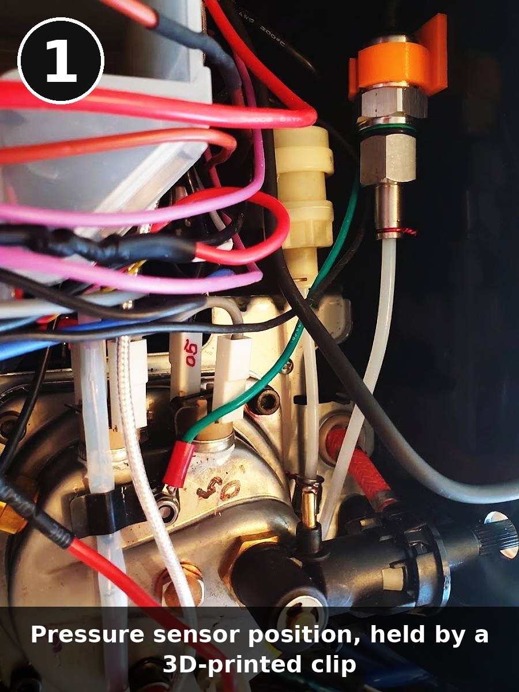</a>&nbsp; <a href="https://raw.githubusercontent.com/centurius222/DeLongezzi/main/docs/plumbing-2.jpg">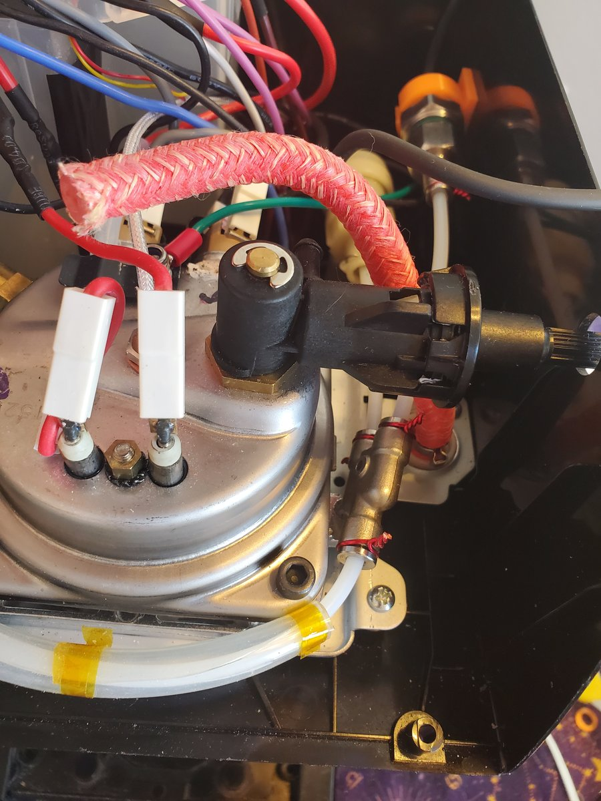</a>&nbsp; <a href="https://raw.githubusercontent.com/centurius222/DeLongezzi/main/docs/plumbing-3.jpg">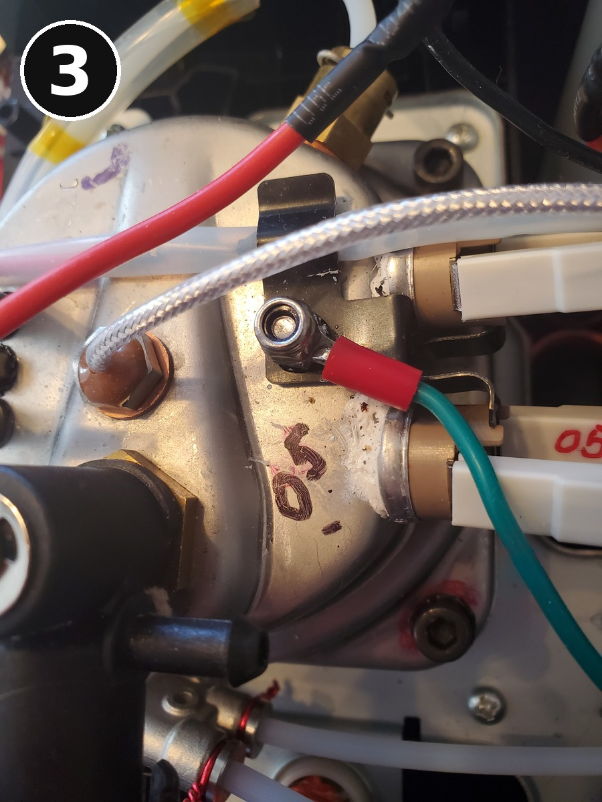</a>

**Step 1. Open the machine:** [DeLonghi teardown video](https://www.youtube.com/watch?v=paImrXJvxlg) (Tom's Coffee Corner).

**Step 2. Plumb it:** follow the diagram and the photos above.

**Need more help?** Ask in the [GaggiMate Discord](https://delta2.eu/discord).


<h2></h2>

## Wiring
<a href="https://raw.githubusercontent.com/centurius222/DeLongezzi/main/docs/wiring-high-voltage.png">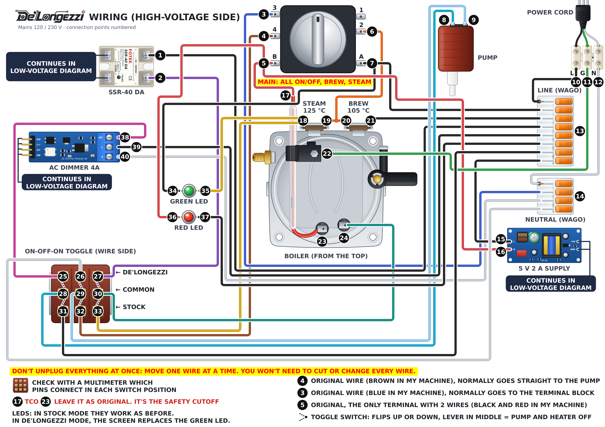</a>&nbsp; <a href="https://raw.githubusercontent.com/centurius222/DeLongezzi/main/docs/wiring-low-voltage.png">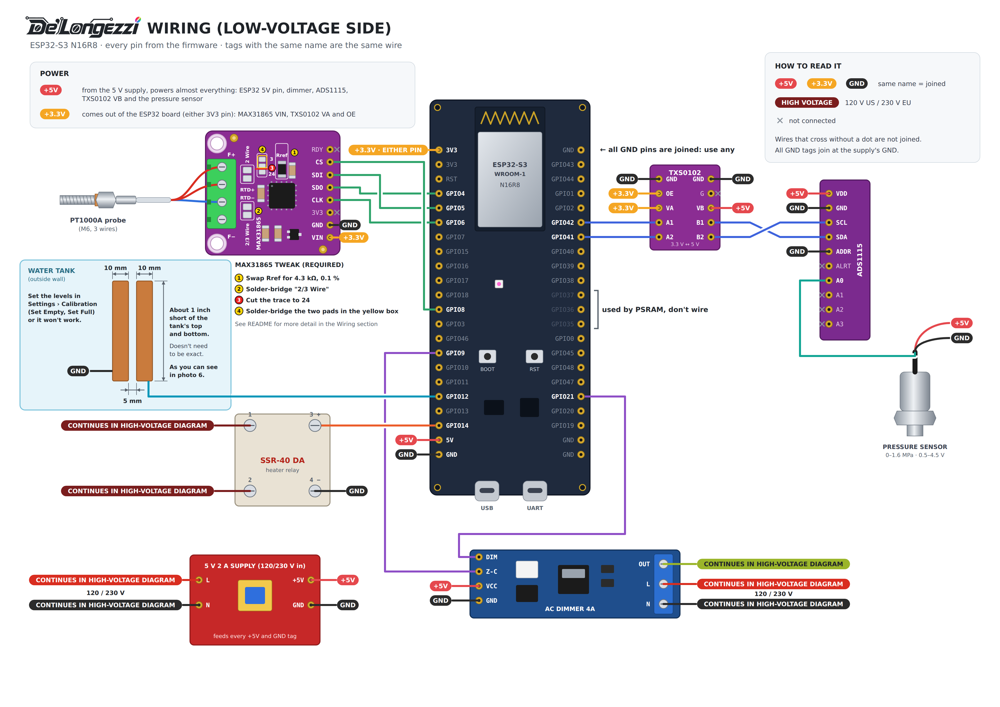</a>

<a href="https://raw.githubusercontent.com/centurius222/DeLongezzi/main/docs/wiring-1.jpg">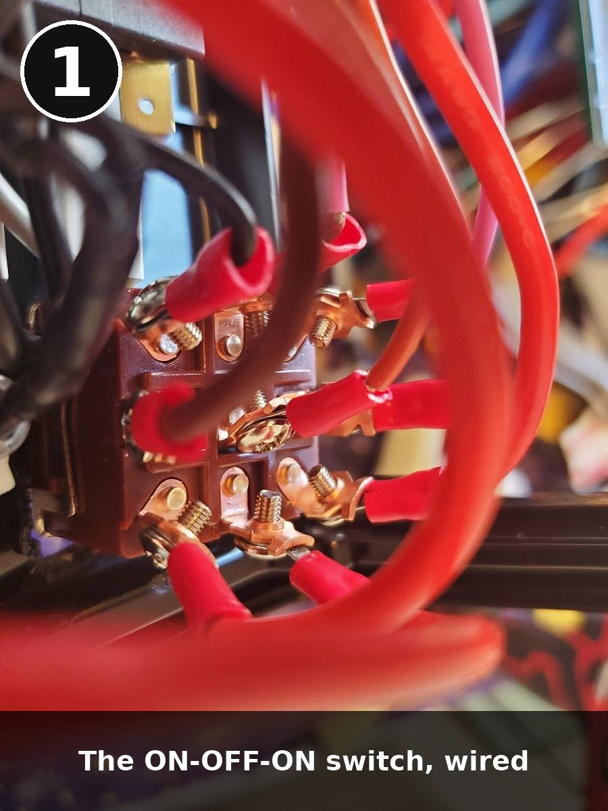</a>&nbsp; <a href="https://raw.githubusercontent.com/centurius222/DeLongezzi/main/docs/wiring-2.jpg">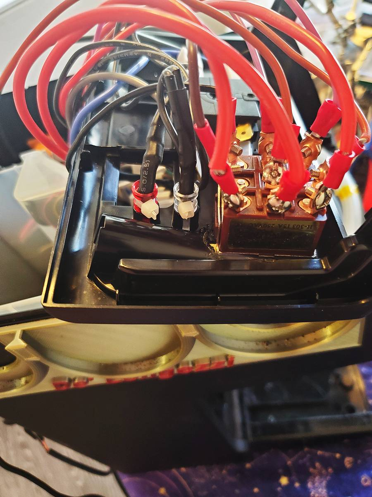</a>&nbsp; <a href="https://raw.githubusercontent.com/centurius222/DeLongezzi/main/docs/wiring-3.jpg">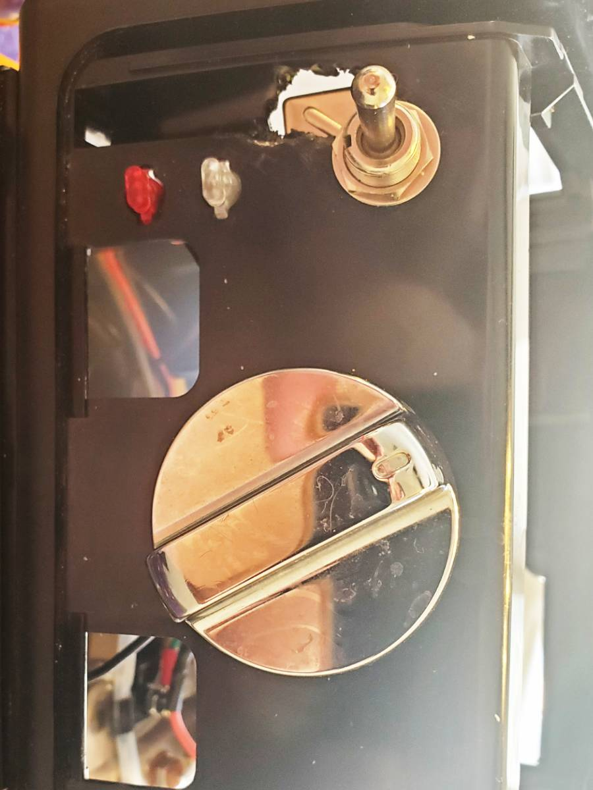</a>&nbsp; <a href="https://raw.githubusercontent.com/centurius222/DeLongezzi/main/docs/wiring-4.jpg">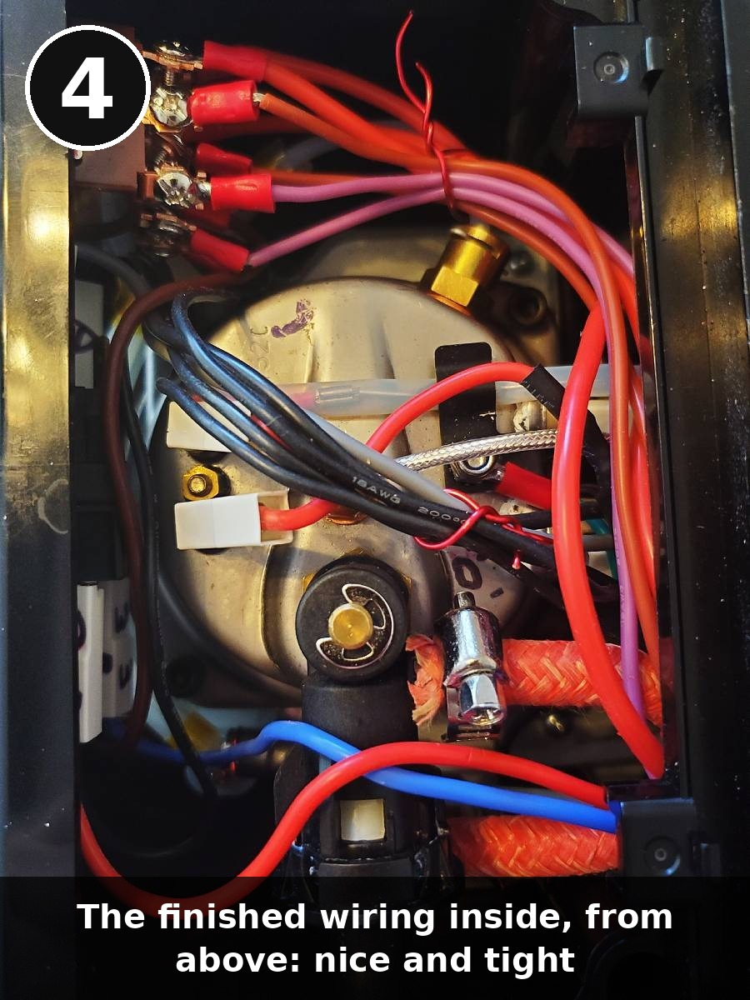</a>&nbsp; <a href="https://raw.githubusercontent.com/centurius222/DeLongezzi/main/docs/wiring-5.jpg">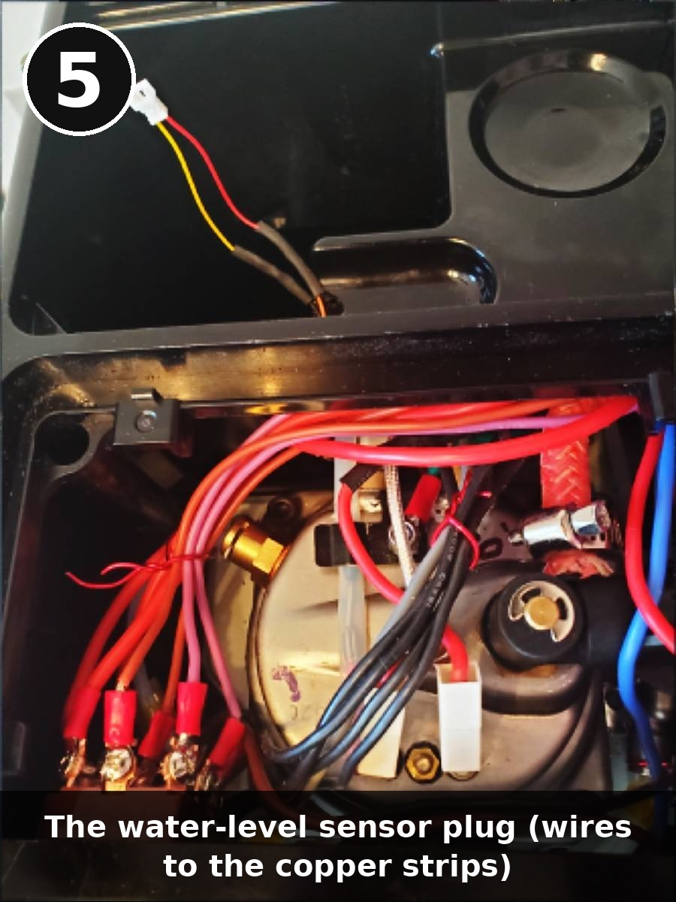</a>&nbsp; <a href="https://raw.githubusercontent.com/centurius222/DeLongezzi/main/docs/wiring-6.jpg">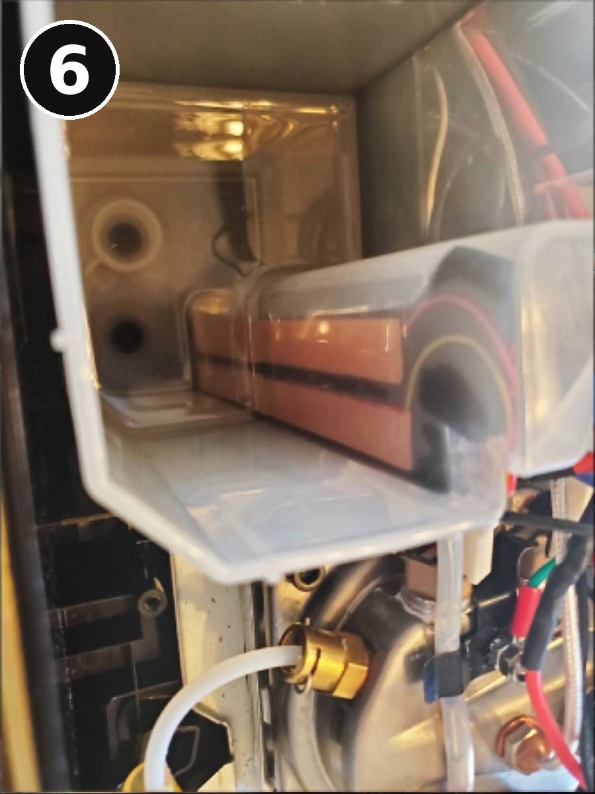</a>

**Step 1. Install the 9-pin switch first:** in stock mode it works as before.

**Step 2. After the switch is wired you can keep brewing:** stock mode works as normal, so add the electronics at<br>
&nbsp;&nbsp;&nbsp;&nbsp;&nbsp;&nbsp;&nbsp;&nbsp;&nbsp;&nbsp;&nbsp;&nbsp;&nbsp;your own pace.

**MAX31865 tweak (required):** for the PT1000A, swap one resistor, add two solder bridges and cut one trace: [MAX31865 guide](docs/max31865.md).

**Original wiring:** [stock ECP wiring in all four switch positions](https://raw.githubusercontent.com/centurius222/DeLongezzi/main/docs/stock-wiring.png).

**Need more help?** Ask in the [GaggiMate Discord](https://delta2.eu/discord).


<h2></h2>

## Flash the firmware
**Turn the machine's mains power off before flashing.** While the board is being flashed no
program runs, so nothing holds the heater and pump outputs off. Flash with the board on USB only.

**Easiest:** the [web flasher](https://centurius222.github.io/DeLongezzi/flasher/), nothing to install
(Chrome on a computer, USB cable). Pick the port named USB JTAG/serial debug unit. Flashing takes a few minutes (16 MB file).

**Or by hand:** download `delongezzi-v2.2.3.bin` from [Releases](https://github.com/centurius222/DeLongezzi/releases/latest)
and write it with [esptool](https://github.com/espressif/esptool):

```sh
esptool.py --chip esp32s3 erase_flash
esptool.py --chip esp32s3 write_flash 0x0 delongezzi-v2.2.3.bin
```

If no port shows up, hold BOOT while you plug in the USB cable.

The file holds the firmware, 32 custom themes, 18 brew-button videos and pictures, 5 starter
profiles and 10 theme fonts, with no Wi-Fi details or passwords in it. Writing it replaces everything on the board
(settings, shots, profiles, themes, videos). The SHA-256 is in the release notes.

<h2></h2>

## First start (Wi-Fi)
1. If the web flasher asked for your Wi-Fi, skip to step 3. Otherwise the board opens a Wi-Fi hotspot
   **DeLongezzi**, password **delongezzi**.
2. Join it, open http://4.4.4.1, enter your Wi-Fi name and password and press Save & restart.
3. The board restarts into your Wi-Fi and is at http://delongezzi.local. If that doesn't open, find its
   address in your router's device list.
4. Change the hotspot password (Settings › Wi-Fi › Access Point Password): the default is public,
   and the hotspot comes back whenever your router can't be reached at start-up.
5. The web page has **no login**: keep the machine on your home network and never forward a port to it.
6. Set the water levels under Settings › Calibration: empty the tank and press Set Empty, then fill it and press Set Full.

<h2></h2>

## Optional extras
- **Theme backup:** `themes/delongezzi-themes-v2.2.2.json` holds the same 32 themes. Restore it under
  Settings › General › Web Settings › Custom Themes › Restore themes.
- **Too many?** Delete the themes and brew-button videos you don't want under Settings › General ›
  Web Settings (Custom Themes, Pictures).

<h2></h2>

## Build from source
- [PlatformIO](https://platformio.org): `pio run` builds `delongezzi-single`; `pio run -t upload`
  flashes the program only (keeps the data).
- The web page is committed ready-built in `src/display/webassets/`. After changing `web/`, run
  `scripts/build_webui.sh` (Node 20.19 or newer, with npm); the next `pio run` builds the new page in (the page's
  checksum is written into `web_ui_blob.S`).
- Libraries are pinned to exact versions. NimBLE-Arduino 1.4.3 is kept in `lib/NimBLE-Arduino` with
  4 memory settings changed (listed at the top of its `nimconfig.h`), and Improv WiFi Library 0.0.4 in
  `lib/ImprovWiFi` with a fix (it dropped the command that came right after a successful one).
- The firmware version comes from the git tag: a build at tag `vX.Y.Z` shows that version, any
  other build shows none.

<h2></h2>

## Disclaimer
By proceeding with this project, you acknowledge and agree that you perform these modifications at your own risk. The author of this guide assumes no liability for any damage to your equipment, property, or injury to yourself or others. If you are unsure about any step, consult a qualified electrician or professional technician.

<h2></h2>

## License
[CC BY-NC-SA 4.0](LICENSE), the same as GaggiMate: free for non-commercial use, with credit, and
changes shared under the same license. Third-party libraries in `lib/` keep their own licenses.

<h2></h2>

## Credits
- [GaggiMate](https://github.com/jniebuhr/gaggimate) by Caffinnova S.r.l., the original.
- Icons: Uicons by [Flaticon](https://www.flaticon.com/uicons) (see `icons/README.md`).
