# Bill of Materials

[← Back to the README](../README.md)

The parts I used: about **$104** in total (AliExpress and Amazon US prices, Oct 2026; prices change).

## Electronics
| &nbsp;&nbsp;&nbsp;&nbsp;&nbsp;&nbsp;&nbsp;&nbsp;&nbsp;&nbsp;&nbsp;&nbsp;&nbsp;&nbsp;&nbsp;&nbsp;&nbsp;&nbsp;&nbsp;&nbsp;&nbsp;&nbsp;&nbsp;&nbsp;&nbsp;&nbsp;&nbsp;&nbsp; | Part | Select | Price | Notes |
|---|---|---|---|---|
| [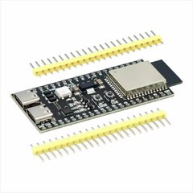](https://www.aliexpress.us/item/3256804864979510.html) | [ESP32-S3 N16R8](https://www.aliexpress.us/item/3256804864979510.html) | ESP32-S3 N16R8; add the green expansion board (+$2.78) | $7.89 | Runs DeLongezzi. The expansion board is highly recommended. |
| [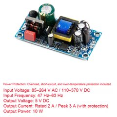](https://www.aliexpress.us/item/3256801318040083.html) | [Power supply 5 V, 2 A](https://www.aliexpress.us/item/3256801318040083.html) | 5V2A | $3.34 | Powers the board. Any power supply with 5 V and at least 2 A works. |
| [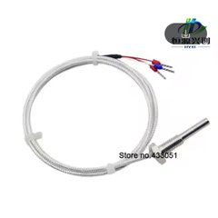](https://www.aliexpress.us/item/2251832775070782.html) | [Temperature probe PT1000A](https://www.aliexpress.us/item/2251832775070782.html) | Pt1000A (M6 is the default size) | $12.99 | Measures boiler temperature. |
| [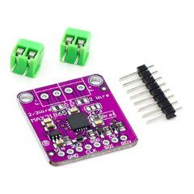](https://www.aliexpress.us/item/3256804375058159.html) | [MAX31865 temperature module](https://www.aliexpress.us/item/3256804375058159.html) | the module only | $3.75 | Reads the probe. |
| [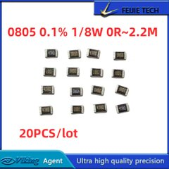](https://www.aliexpress.us/item/3256811650089060.html) | [Precision resistor 0805, 0.1 %, 25 ppm](https://www.aliexpress.us/item/3256811650089060.html) | 4.3K | $3.87 | Reference for the PT1000 on the MAX31865. Must be high precision. |
| [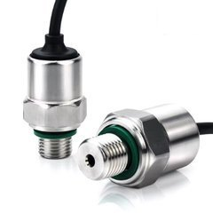](https://www.aliexpress.us/item/3256806962465167.html) | [Pressure sensor transmitter](https://www.aliexpress.us/item/3256806962465167.html) | 5 V, out 0.5–4.5 V, 0–1.6 MPa | $16.58 | Measures brew pressure. Make sure you select exactly this. |
| [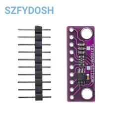](https://www.aliexpress.us/item/3256807720160490.html) | [ADS1115 module](https://www.aliexpress.us/item/3256807720160490.html) | ADS1115 purple | $1.85 | Reads the pressure sensor. |
| [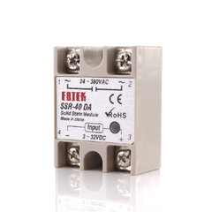](https://www.aliexpress.us/item/3256805757594761.html) | [SSR-40DA](https://www.aliexpress.us/item/3256805757594761.html) |  | $3.45 | Switches the heater. |
| [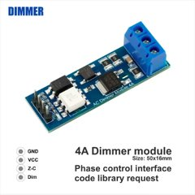](https://www.aliexpress.us/item/2251832615710334.html) | [AC dimmer module](https://www.aliexpress.us/item/2251832615710334.html) | 4A Standard | $4.14 | Controls the pump. |
| [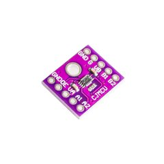](https://www.aliexpress.us/item/3256806645215203.html) | [TXS0102 level shifter (2-bit)](https://www.aliexpress.us/item/3256806645215203.html) |  | $1.60 |  |
| [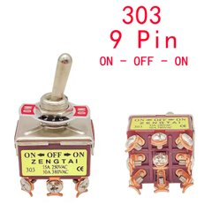](https://www.aliexpress.us/item/3256801537983239.html) | [E-TEN rocker switch](https://www.aliexpress.us/item/3256801537983239.html) | 303 ON-OFF-ON (9 pins) | $4.48 |  |
| [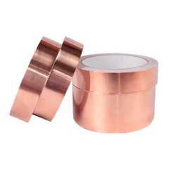](https://www.aliexpress.us/item/3256804011875638.html) | [Copper tape](https://www.aliexpress.us/item/3256804011875638.html) | 10 mm | $1.93 | For the water-level sensor on the tank. |
|  | Box for the electronics | 3D print or buy one | — | Everything goes in one box: board, modules and SSR. |

## Plumbing
| &nbsp;&nbsp;&nbsp;&nbsp;&nbsp;&nbsp;&nbsp;&nbsp;&nbsp;&nbsp;&nbsp;&nbsp;&nbsp;&nbsp;&nbsp;&nbsp;&nbsp;&nbsp;&nbsp;&nbsp;&nbsp;&nbsp;&nbsp;&nbsp;&nbsp;&nbsp;&nbsp;&nbsp; | Part | Select | Price | Notes |
|---|---|---|---|---|
| [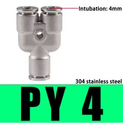](https://www.aliexpress.us/item/3256807742393521.html) | [PY4 Y connector](https://www.aliexpress.us/item/3256807742393521.html) |  | $4.52 | Joins the pressure sensor and the pump. |
|  | [Pressure sensor adapter PCF 4-02](https://www.aliexpress.us/item/3256810136023717.html) | 4 mm – 1/4" | $2.72 | PCF: don't forget it. |
|  | [Black O-ring](https://www.aliexpress.us/item/3256811893161515.html) | ID 11.2 × CS 2.65 (30 pcs) | $2.76 | For the pressure sensor adapter: goes on top of the green ring that's already there, which seals the whole thing. |
| [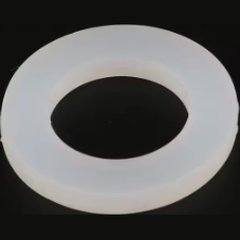](https://www.aliexpress.us/item/2255799841120591.html) | [Silicone flat gasket](https://www.aliexpress.us/item/2255799841120591.html) | white, 1/4", 3 mm | $1.79 | Inside the pressure adapter PCF 4-02. |
| [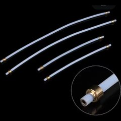](https://www.aliexpress.us/item/3256808808844767.html) | [Tubes 2.0 × 4.0 mm, 250 mm](https://www.aliexpress.us/item/3256808808844767.html) | 2 pieces | $1.78 | Water lines. You can reuse the old tube from the tank; you'll still need one for the pump side. Measure twice, cut once. Cut the new tubes to 5 mm tips like the original ones, straight, with a razor blade. |
| [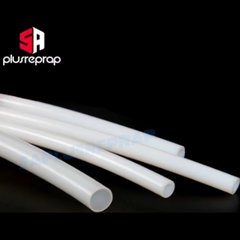](https://www.aliexpress.us/item/2251832544541096.html) | [PTFE tube 2 × 4 mm, 1 m](https://www.aliexpress.us/item/2251832544541096.html) | white | $2.66 |  |
| [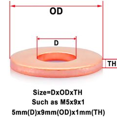](https://www.aliexpress.us/item/3256809079827189.html) | [Copper washers M6 × 12 × 1](https://www.aliexpress.us/item/3256809079827189.html) | 10 pcs | $2.80 | Seals the probe in the boiler. You need one on the outside of the temperature probe. |
| [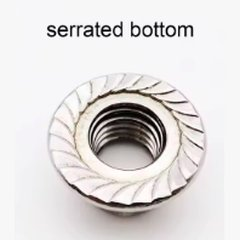](https://www.aliexpress.us/item/2255800062569581.html) | [Flange lock nut M6](https://www.aliexpress.us/item/2255800062569581.html) | M6, serrated bottom | $1.78 | Holds the probe in the boiler. One, for the temperature probe, inside the boiler. |
| [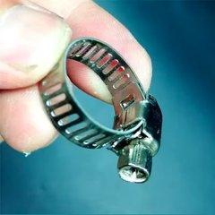](https://www.aliexpress.us/item/3256807093035944.html) | [Stainless hose clamps](https://www.aliexpress.us/item/3256807093035944.html) | 8–12 mm (10 pcs) | $1.79 | To replace the steam wand clips. |
| [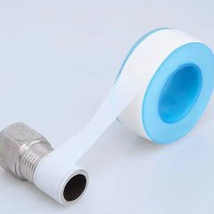](https://www.aliexpress.us/item/3256807483217539.html) | [Teflon (plumber's) tape](https://www.aliexpress.us/item/3256807483217539.html) |  | $1.16 | Seals threads. |

## Wiring
| &nbsp;&nbsp;&nbsp;&nbsp;&nbsp;&nbsp;&nbsp;&nbsp;&nbsp;&nbsp;&nbsp;&nbsp;&nbsp;&nbsp;&nbsp;&nbsp;&nbsp;&nbsp;&nbsp;&nbsp;&nbsp;&nbsp;&nbsp;&nbsp;&nbsp;&nbsp;&nbsp;&nbsp; | Part | Select | Price | Notes |
|---|---|---|---|---|
|  | [Silicone wire](https://www.aliexpress.us/item/2255801097491499.html) | 18 AWG | $3.20 | For all wiring. Rated to 200 °C. 18 AWG is what GaggiMate uses; 16 AWG is safer. |
| [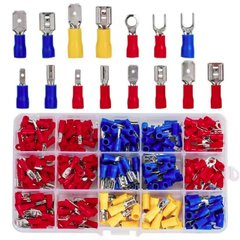](https://www.aliexpress.us/item/3256812100899843.html) | [Cold-pressed terminal kit](https://www.aliexpress.us/item/3256812100899843.html) | 280 pcs | $5.15 | For the wire ends. |
| [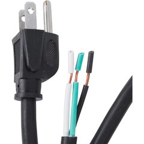](https://www.amazon.com/dp/B07BQCMPF2) | [Power cord, 3-prong](https://www.amazon.com/dp/B07BQCMPF2) | 13 A rated | $4.61 | To ground the boiler. |
| [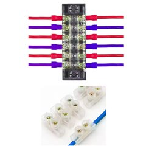](https://www.aliexpress.us/item/3256805905106307.html) | [Wago connectors](https://www.aliexpress.us/w/wholesale-wago-connectors.html) or [terminal block](https://www.aliexpress.us/item/3256805905106307.html) | 12P white strip, 20A | $1.34 | Joins wires. Up to you, everyone does it differently. |

**Need more help?** Ask in the [GaggiMate Discord](https://delta2.eu/discord).
