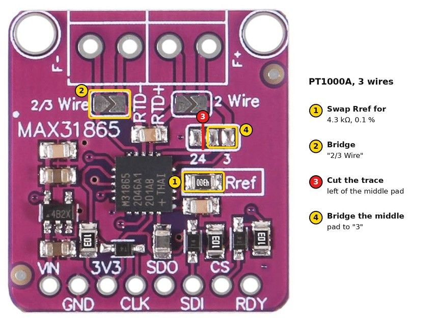

# MAX31865 for the PT1000A probe

[← Back to the parts list](BOM.md)

This build uses a PT1000A probe on 3 wires, so the MAX31865 module needs two changes before you
wire it. Use a fine soldering tip: the resistor is tiny (0805).

## 1. Reference resistor (PT1000)
Remove the factory reference resistor next to "Rref" and solder the 4.3 kΩ 0.1 % one in its place.

## 2. 3-wire mode
1. Bridge the "2/3 Wire" pads with solder.
2. Cut the thin trace between the middle pad and "24".
3. Bridge the middle pad to "3".

**Need more help?** Ask in the [GaggiMate Discord](https://delta2.eu/discord).
